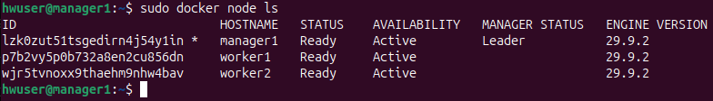
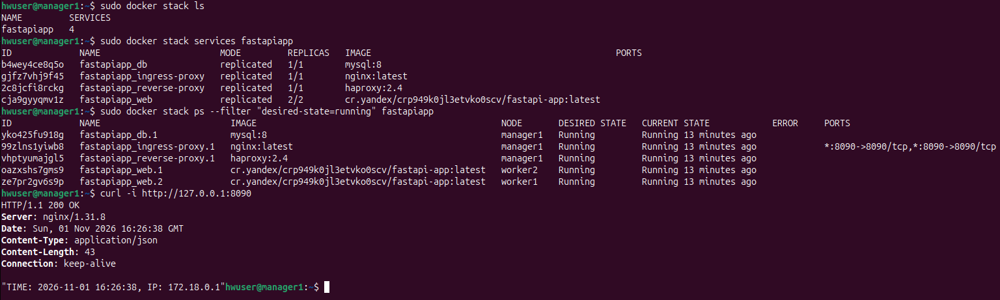
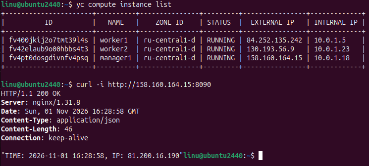

# Домашнее задание к занятию 6. «Оркестрация кластером Docker контейнеров на примере Docker Swarm» - Розаев А.Ю.

#### Это задание для самостоятельной отработки навыков и не предполагает обратной связи от преподавателя. Его выполнение не влияет на завершение модуля. Но его рекомендуется выполнить, чтобы закрепить полученные знания.

-----

## Задача 1

Создан Docker Swarm-кластер в Яндекс Облаке. [Документация](https://docs.docker.com/engine/reference/commandline/swarm_init/):

1. Созданы 3 облачные виртуальные машины в одной сети.
2. Установлен docker на каждую ВМ.
3. Создан swarm-кластер из 1 мастера и 2-х рабочих нод.
4. Проверен список нод командой:
```
docker node ls
```



---

## Задача 2 (*) (необязательное задание *).

1. В получившийся кластер задеплойен python-fork проект из предыдущего ДЗ (05-virt-04-docker-in-practice).





---

## Задача 3 (*)

Кластер развернут с помощью terraform и ansible со статический инвентарем.


